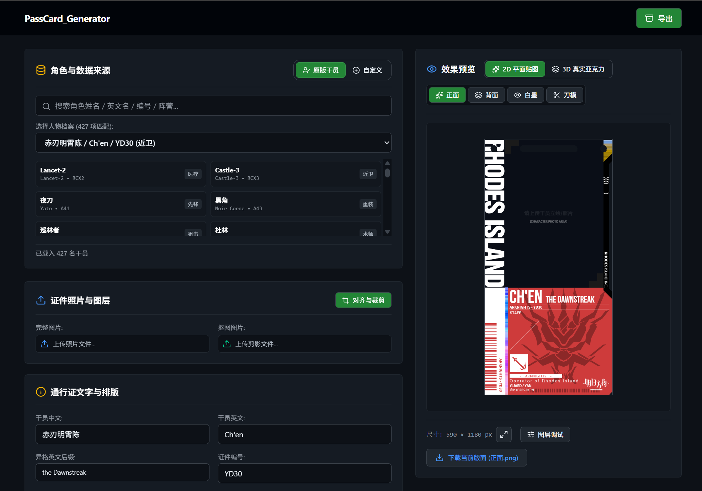

# PCB-PassCard-Generator
### 界面预览


## 功能

- 查询和选择内置角色，或切换到自定义录入编辑通行证信息。
- 调整姓名、编号、职业、阵营、颜色和图标，上传照片及透明抠图。
- 对齐与裁剪图片，调整阵营图标位置和大小，控制预览图层。
- 下载单张 PNG，或将正面、背面、白墨、刀模打包为 ZIP；图纸尺寸为 590 × 1180 px。
- 预览亚克力卡片的 3D 效果，导出旋转 GIF，并通过 AprilTag 锚点进行 AR 预览。

## 本地运行

需要 Node.js 20.19+ 或 22.12+，推荐使用 Chrome 或 Edge。

```powershell
npm ci
npm run dev
```

开发页面：`http://127.0.0.1:3000/PassCard_Generator.html`。

## 构建与部署

```powershell
npm run lint
npm run build
npm run preview
```

构建产物在 `dist/`，入口为 `PassCard_Generator.html`。部署时一起发布整个 `dist/`，通过站点下的 `/PassCard_Generator.html` 访问应用；入口 HTML 和旁边的 `PassCard_Generator_assets/` 必须保留相对目录关系。

构建只写入本仓库的 `dist/`，不再向 PCB 编辑器仓库复制文件。源码入口需要通过 Vite 启动；浏览器直接双击源码 HTML 无法运行 React／TypeScript。

AR 摄像头预览需要支持摄像头的浏览器、HTTPS 或 localhost，以及摄像头权限。角色库和裁剪偏好保存在当前浏览器的本地存储中；新站点不会自动读取旧站点的本地存储。

## 感谢

- 感谢项目 [SusieGlitter/txz](https://github.com/SusieGlitter/txz) 提供通行证生成器的核心代码、角色数据与模板素材，包括渲染、裁剪、3D、GIF 和 AR 功能。
- 该仓库的代码与资源为本项目的功能迁移、独立化和后续开发提供了基础与参考。

## 声明

本网站是一款通过明日方舟通行证模板生成PCB板图片的工具（以下简称“本工具”），**主要面向学习与个人创作**。

1. **素材版权由使用者负责**：本工具不会为输入图像做版权审查。若您使用他人的原创作品（插画、角色形象、图片等）进行制作，请确保已获得相应授权；因素材侵权产生的纠纷与责任由使用者自行承担，与作者及本工具无关。
2. **肖像与隐私**：请勿使用本工具处理涉及他人肖像、隐私或敏感内容的图像。
3. **商用免责**：若有商家／商贩使用本工具进行 PCB 周边产品的生产与销售，由此产生的产品质量、商业模式、版权纠纷及其他一切问题与后果，均与作者及本工具无关，作者不承担任何责任。
4. **按现状提供（AS-IS）**：本工具按现状提供，不附带任何明示或暗示的担保，作者不对其适用性、可靠性或特定用途作出任何保证。
5. 使用本工具即视为已阅读并同意以上内容。